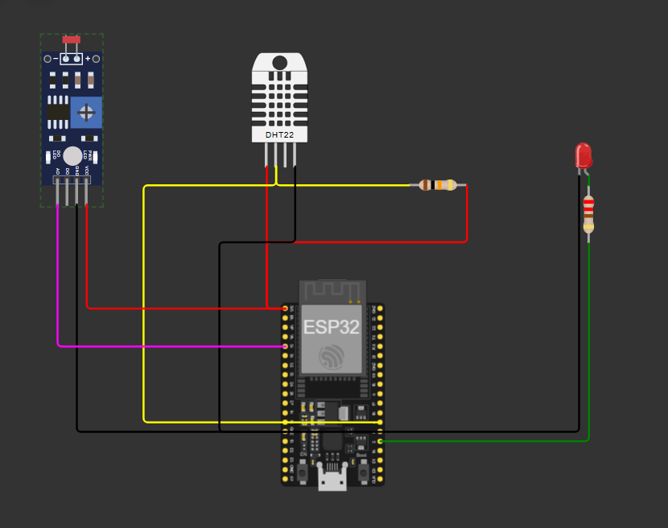
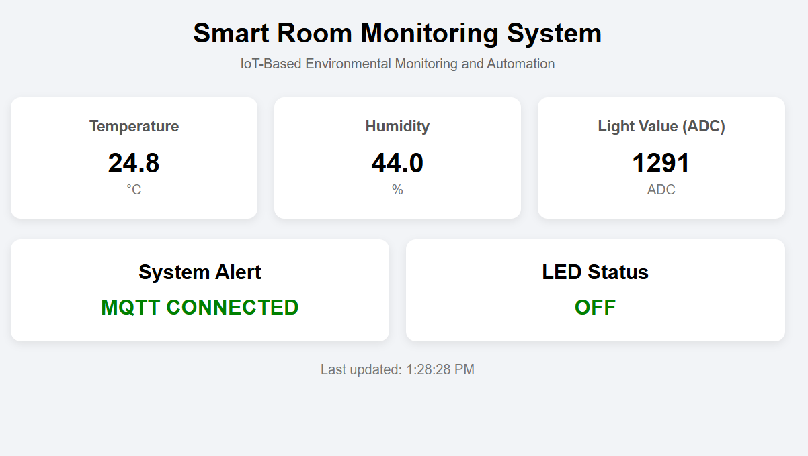
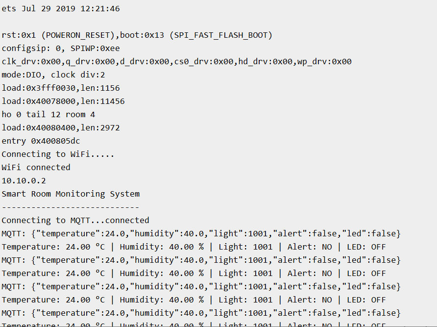

# Smart Room Monitoring System

An IoT-based environmental monitoring and alert system built using **ESP32, DHT22, LDR, MQTT, and a real-time web dashboard**.

## Overview

The Smart Room Monitoring System monitors **temperature, humidity, and ambient light levels** using an ESP32. The sensor readings are transmitted over Wi-Fi using the **MQTT protocol** and displayed on a web-based dashboard in real time.

The system also implements simple threshold-based alert logic. If the temperature becomes too high or the light level becomes too low, an LED is activated and the dashboard displays an alert.

The complete prototype was developed and tested using the **Wokwi simulation environment**.

## System Architecture

```text
        DHT22
          │
          │
        LDR
          │
          ▼
        ESP32
          │
       Wi-Fi
          │
          ▼
    MQTT Broker
      HiveMQ
          │
          │ MQTT
          ▼
   Web Dashboard
          │
    ┌─────┼─────┐
    ▼     ▼     ▼
  Temp  Humidity Light
          │
          ▼
     Alert Status
          │
          ▼
        LED
```

## Features

- Real-time temperature monitoring
- Real-time humidity monitoring
- Ambient light-level monitoring
- MQTT-based wireless communication
- Real-time web dashboard
- Threshold-based alert detection
- LED indication during alert conditions
- Complete Wokwi-based simulation

## Components

| Component | Purpose |
|---|---|
| ESP32 | Main microcontroller |
| DHT22 | Temperature and humidity sensing |
| LDR | Ambient light sensing |
| LED | Alert indication |
| MQTT | Wireless data communication |
| Web Dashboard | Real-time data visualization |

## Pin Configuration

| Component | ESP32 Pin |
|---|---|
| DHT22 Data | GPIO 4 |
| LDR Analog Output | GPIO 34 |
| LED | GPIO 2 |

## Alert Conditions

The system uses simple threshold-based logic:

| Condition | Result |
|---|---|
| Temperature > 30°C | ALERT |
| Light Level < 500 ADC | ALERT |
| Otherwise | NORMAL |

When an alert condition is detected:

- LED turns **ON**
- Dashboard status changes to **ALERT**

Humidity is monitored and displayed but is not currently used as an alert trigger.

## MQTT Communication

The ESP32 publishes sensor data using MQTT.

**Broker:** `broker.hivemq.com`  
**Port:** `1883`  
**Topic:** `smartroom/data`

Example MQTT message:

```json
{
  "temperature": 24.8,
  "humidity": 44.0,
  "light": 1001,
  "alert": false,
  "led": false
}
```

## Dashboard

The web dashboard receives MQTT messages over WebSockets and displays the latest sensor readings in real time.

The dashboard displays:

- Temperature
- Humidity
- Light Level (ADC)
- System Alert
- LED Status
- Last Updated Time

> **Note:** The LDR value is a raw ADC reading and is not calibrated to lux.

## Testing

Three operating conditions were tested in the Wokwi simulation.

| Test Case | Temperature | Humidity | Light | Alert | LED |
|---|---:|---:|---:|---|---|
| Normal Operation | 24.8°C | 44% | 1262 | NORMAL | OFF |
| High Temperature | 35.8°C | 44% | 680 | ALERT | ON |
| Low Light | 24.8°C | 44% | 240 | ALERT | ON |

## Screenshots

### Wokwi Circuit



### Dashboard



### Wokwi Serial Monitor



## Project Structure

```text
IOT_Smart_Home_Automation_and_Monitoring/
│
├── README.md
│
├── dashboard/
│   └── index.html
│
├── firmware/
│   └── smart_room_monitor.ino
│
├── screenshots/
│   ├── .gitkeep
│   ├── dashboard_smart_home.png
│   ├── wokwi_circuit_Smart_home.png
│   └── wokwi_dashboard_Serial_monitor.png
│
└── docs/
    └── project_report.pdf
```

## Wokwi Simulation

The complete system was developed and tested using Wokwi.

**[Open Wokwi Simulation](YOUR_WOKWI_LINK)**

## Limitations

- The system was tested in a simulation environment rather than on physical hardware.
- The LDR output is represented as a raw ADC value and is not calibrated to lux.
- Fixed threshold values are currently used for alert detection.
- The project uses a public MQTT broker for demonstration purposes.
- No historical sensor-data database is implemented.

## Future Improvements

- Deploy the system on physical ESP32 hardware.
- Calibrate the LDR for actual light-intensity measurements.
- Add configurable alert thresholds.
- Add historical data visualization.
- Add additional environmental sensors.
- Use secure MQTT communication.
- Add mobile or notification-based alerts.
- Add automatic control of room appliances such as lights or fans.

## Technologies Used

- **ESP32**
- **Arduino / C++**
- **DHT22**
- **LDR**
- **MQTT**
- **HiveMQ**
- **HTML / CSS / JavaScript**
- **Wokwi**

## Author

**Harsh Gupta**  
B.Tech Electronics & Communication Engineering  
MIT Manipal
